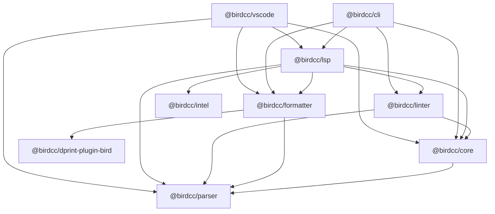

<div align="center">


# BIRD-LSP

Language server, linter, formatter, and CLI for BIRD 2 and BIRD 3 configuration files.

[](https://marketplace.visualstudio.com/items?itemName=BIRDCC.bird2-lsp)
[](https://open-vsx.org/extension/BIRDCC/bird2-lsp)
[](https://www.npmjs.com/package/@birdcc/cli)
[](https://github.com/bird-chinese-community/BIRD-LSP/actions/workflows/ci.yml)
[](./LICENSE)

English | [简体中文](./README.zh.md)

</div>

## Features

- **Parsing**: a Tree-sitter grammar, compiled to WebAssembly, parses BIRD 2 and BIRD 3 configuration files and recovers from syntax errors, so declarations after an error are still analyzed.
- **Diagnostics**: 32 lint rules in six groups (`sym`, `cfg`, `net`, `type`, `bgp`, `ospf`). Analysis follows `include` statements across files, by default up to 16 levels and 256 files. `birdcc lint --bird` also runs `bird -p` on each checked file.
- **Formatting**: two engines, a dprint plugin written in Rust and compiled to WebAssembly (default) and a built-in TypeScript formatter. Safe mode parses the input and the output and rejects the output when the declarations or parse errors differ.
- **Editor features**: completion, keyword and symbol hover, go to definition across included files, find references to templates in `from` clauses across the include graph, document symbols, document formatting, and inlay hints for function return types and AS numbers.
- **ASN data**: `@birdcc/intel` ships an offline AS number database built from BGP.Tools OpenDB. The language server uses it for ASN completion, hover, and inlay hints.
- **Project configuration**: `bird.config.json` sets the entry file or a list of workspaces, include paths, analysis limits, rule severities, formatter options, and the `bird -p` command. `birdcc init` detects the entry file and writes the configuration.

## Getting started

### Editors

- **VS Code** 1.100 or newer, and editors that install from Open VSX: install [`BIRDCC.bird2-extension-pack`](https://marketplace.visualstudio.com/items?itemName=BIRDCC.bird2-extension-pack) ([Open VSX](https://open-vsx.org/extension/BIRDCC/bird2-extension-pack)). It contains [`BIRDCC.bird2-lsp`](./packages/@birdcc/vscode/README.md), which bundles the language server, and the syntax highlighting extension `BIRDCC.vscode-bird2-conf`.
- **Neovim, Vim, Helix, JetBrains IDEs, and other LSP clients**: start the language server with `birdcc lsp --stdio` from `@birdcc/cli`. [BIRD.nvim](https://github.com/bird-chinese-community/BIRD.nvim) and [BIRD.vim](https://github.com/bird-chinese-community/BIRD.vim) add filetype detection and highlighting.

Read more » [Installation](https://bird-chinese-community.github.io/en/getting-started/installation/)

### CLI

The CLI requires Node.js 22 or newer.

```bash
npm install -g @birdcc/cli

birdcc init --write            # detect the entry file and write bird.config.json
birdcc lint                    # lint the entry file named in bird.config.json
birdcc lint bird.conf --bird   # also run `bird -p`
birdcc fmt bird.conf           # exit 1 if the file needs formatting
birdcc fmt bird.conf --write   # format in place
birdcc lsp --stdio             # start the language server
```

Read more » [Quick start](https://bird-chinese-community.github.io/en/getting-started/quick-start/) · [CLI reference](https://bird-chinese-community.github.io/en/cli/) · [Lint rules](https://bird-chinese-community.github.io/en/linting/rules/)

### GitHub Actions

[setup-birdcc](https://github.com/bird-chinese-community/setup-birdcc) prepares a GitHub Actions runner with Node.js, pnpm, and BIRD for `birdcc lint`, `birdcc fmt --check`, and `bird -p` jobs.

Read more » [GitHub Actions](https://bird-chinese-community.github.io/en/ci/github-actions/)

## Packages

| Package                                                                | Distribution                  | Contents                                                                                           |
| ---------------------------------------------------------------------- | ----------------------------- | -------------------------------------------------------------------------------------------------- |
| [`@birdcc/parser`](./packages/@birdcc/parser/)                         | npm                           | Tree-sitter grammar, WebAssembly build, `parseBirdConfig`                                          |
| [`@birdcc/core`](./packages/@birdcc/core/)                             | npm                           | Symbol table, type checks, cross-file `include` resolution, project configuration, entry detection |
| [`@birdcc/linter`](./packages/@birdcc/linter/)                         | npm                           | 32 lint rules                                                                                      |
| [`@birdcc/formatter`](./packages/@birdcc/formatter/)                   | npm                           | dprint and built-in formatting engines, safe mode                                                  |
| [`@birdcc/dprint-plugin-bird`](./packages/@birdcc/dprint-plugin-bird/) | npm                           | dprint plugin compiled from Rust to WebAssembly                                                    |
| [`@birdcc/intel`](./packages/@birdcc/intel/)                           | npm                           | Offline ASN database                                                                               |
| [`@birdcc/lsp`](./packages/@birdcc/lsp/)                               | npm                           | Language server                                                                                    |
| [`@birdcc/cli`](./packages/@birdcc/cli/)                               | npm                           | `birdcc` command: `init`, `lint`, `fmt`, `lsp`                                                     |
| [`@birdcc/vscode`](./packages/@birdcc/vscode/)                         | VS Code Marketplace, Open VSX | VS Code extension `BIRDCC.bird2-lsp`                                                               |
| [`bird2-extension-pack`](./packages/@birdcc/vscode-pack/)              | VS Code Marketplace, Open VSX | Extension pack `BIRDCC.bird2-extension-pack`: `BIRDCC.bird2-lsp` and `BIRDCC.vscode-bird2-conf`    |

Read more » [npm packages](https://bird-chinese-community.github.io/en/packages/)

## Architecture

An arrow points from a package to a package it lists in `dependencies`. Select a package to open its README.



Read more » [Architecture](https://bird-chinese-community.github.io/en/architecture/)

## Development

Building needs Node.js 22 or newer, pnpm, and Rust with the `wasm32-unknown-unknown` target and the `llvm-tools` component.

```bash
git clone https://github.com/bird-chinese-community/BIRD-LSP.git
cd BIRD-LSP
git submodule update --init --depth 1 refer/BIRD-source-code refer/BIRD-tm-language-grammar refer/BIRD2-vim-grammar
rustup target add wasm32-unknown-unknown
rustup component add llvm-tools
pnpm install
pnpm build
pnpm test
```

Read more » [Contributing](https://bird-chinese-community.github.io/en/contributing/)

## Documentation

[BIRDCC User Guide & Technical Reference (Developer Preview)](https://bird-chinese-community.github.io/en/) documents the editors, the CLI, the lint rules, `bird.config.json`, the language server, and the internals, in English and Simplified Chinese.

- [Entry files and includes](https://bird-chinese-community.github.io/en/configuration/entries-and-includes/) and the [configuration reference](https://bird-chinese-community.github.io/en/configuration/reference/)
- [VS Code settings](https://bird-chinese-community.github.io/en/editors/vscode/#settings) and the [language server reference](https://bird-chinese-community.github.io/en/editors/language-server/)
- [FAQ](https://bird-chinese-community.github.io/en/faq/)
- BIRD user guide: [BIRD 2](https://bird.network.cz/?get_doc&f=bird.html&v=20), [BIRD 3](https://bird.network.cz/?get_doc&f=bird.html&v=30)

## Feedback

- [Report a bug](https://github.com/bird-chinese-community/BIRD-LSP/issues/new?template=bug-report.yml)
- [Request a feature](https://github.com/bird-chinese-community/BIRD-LSP/issues/new?template=feature-request.yml)
- [Report a security issue](./SECURITY.md)

## License

[GPL-3.0-only](./LICENSE). BIRD-LSP is maintained by the BIRD Chinese Community (BIRDCC). BIRD is developed by CZ.NIC Labs; this project is not affiliated with CZ.NIC.

## Acknowledgements

<!-- prettier-ignore-start -->

<!-- CI START -->
We gratefully acknowledge these upstream repositories for the real-world BIRD configuration examples that help validate parsing, formatting, linting, and editor support in this project:

- [`PoemaIX/IX-BIRD-RS-Generator`](https://github.com/PoemaIX/IX-BIRD-RS-Generator)
- [`HuJK-Data/JKNET-BIRD`](https://github.com/HuJK-Data/JKNET-BIRD)
- [`@LaunchPad-Network`](https://github.com/LaunchPad-Network) *(private feed)*
- [`186526/net186-config`](https://github.com/186526/net186-config)
- [`SunyzNET/bird-config`](https://github.com/SunyzNET/bird-config)
- [`tianshome/bird-configs-output`](https://github.com/tianshome/bird-configs-output)
<!-- CI END -->

<!-- prettier-ignore-end -->
