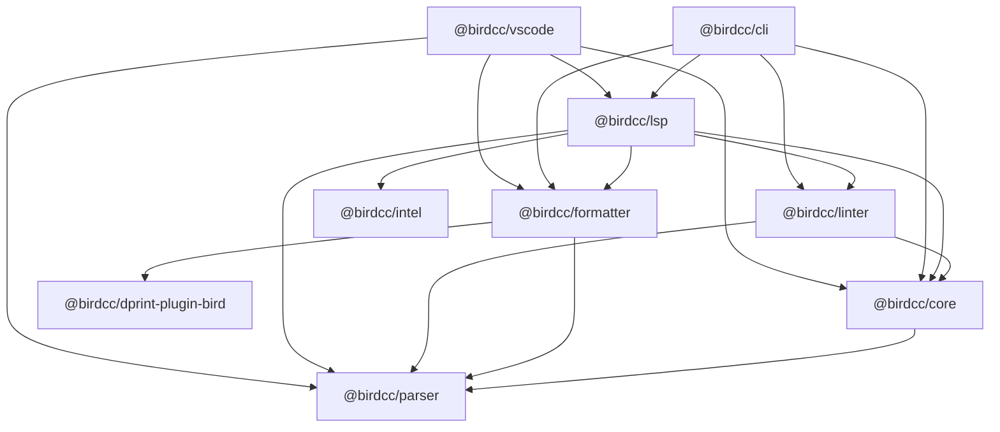

<div align="center">


# BIRD-LSP

BIRD 2 与 BIRD 3 配置文件的语言服务器、Linter、格式化器与命令行工具。

[](https://marketplace.visualstudio.com/items?itemName=BIRDCC.bird2-lsp)
[](https://open-vsx.org/extension/BIRDCC/bird2-lsp)
[](https://www.npmjs.com/package/@birdcc/cli)
[](https://github.com/bird-chinese-community/BIRD-LSP/actions/workflows/ci.yml)
[](./LICENSE)

[English](./README.md) | 简体中文

</div>

## 功能

- **解析**：Tree-sitter 语法编译成 WebAssembly，解析 BIRD 2 与 BIRD 3 配置文件。遇到语法错误时继续解析，错误之后的声明照常参与分析。
- **诊断**：32 条 lint 规则，分为 `sym`、`cfg`、`net`、`type`、`bgp`、`ospf` 六组。分析会跟随 `include` 语句读取其他文件，默认最多 16 层、256 个文件。`birdcc lint --bird` 还会对每个被检查的文件运行 `bird -p`。
- **格式化**：两个引擎。默认引擎是用 Rust 编写、编译成 WebAssembly 的 dprint 插件，另一个是内置的 TypeScript 格式化器。安全模式会分别解析输入与输出，两者的声明或解析错误不一致时拒绝输出。
- **编辑器功能**：补全、关键字与符号悬停提示、跨 include 文件的跳转定义、在整个 include 图中查找 `from` 子句对模板的引用、文档符号、文档格式化，以及函数返回类型与 AS 号的内嵌提示（inlay hints）。
- **ASN 数据**：`@birdcc/intel` 附带一份离线 AS 号数据库，数据来自 BGP.Tools OpenDB。语言服务器用它提供 ASN 补全、悬停提示与内嵌提示。
- **项目配置**：`bird.config.json` 指定入口文件或一组工作区目录、include 搜索路径、分析上限、规则级别、格式化选项和 `bird -p` 命令。`birdcc init` 会探测入口文件并写出这份配置。

## 快速上手

### 编辑器

| 编辑器                                                 | 安装                                                                                                                                                                                       | 得到的功能                                                                                                                           |
| ------------------------------------------------------ | ------------------------------------------------------------------------------------------------------------------------------------------------------------------------------------------ | ------------------------------------------------------------------------------------------------------------------------------------ |
| VS Code 1.100 及以上，以及从 Open VSX 安装扩展的编辑器 | [`BIRDCC.bird2-extension-pack`](https://marketplace.visualstudio.com/items?itemName=BIRDCC.bird2-extension-pack)（[Open VSX](https://open-vsx.org/extension/BIRDCC/bird2-extension-pack)） | [`BIRDCC.bird2-lsp`](./packages/@birdcc/vscode/README.md) 提供语言功能，扩展内置语言服务器；`BIRDCC.vscode-bird2-conf` 提供语法高亮  |
| Neovim 0.11 及以上                                     | [BIRD.nvim](https://github.com/bird-chinese-community/BIRD.nvim) 与 `@birdcc/cli`                                                                                                          | BIRD.nvim 提供文件类型识别与语法高亮；`birdcc lsp --stdio` 提供语言功能（[配置方法](./packages/@birdcc/lsp/README.md#editor-setup)） |
| Vim                                                    | [BIRD.vim](https://github.com/bird-chinese-community/BIRD.vim)                                                                                                                             | 文件类型识别与语法高亮                                                                                                               |
| Helix 及其他 LSP 客户端                                | `@birdcc/cli`                                                                                                                                                                              | `birdcc lsp --stdio` 提供语言功能（[配置方法](./packages/@birdcc/lsp/README.md#editor-setup)）                                       |

### 命令行

命令行工具需要 Node.js 22 或更新版本。

```bash
npm install -g @birdcc/cli

birdcc init --write            # 探测入口文件并写出 bird.config.json
birdcc lint                    # 检查 bird.config.json 中指定的入口文件
birdcc lint bird.conf --bird   # 同时运行 `bird -p`
birdcc fmt bird.conf           # 文件需要格式化时退出码为 1
birdcc fmt bird.conf --write   # 原地格式化
birdcc lsp --stdio             # 启动语言服务器
```

规则默认报告 `warning` 或 `info`。出现 `error` 级别的诊断时 `birdcc lint` 以退出码 1 结束，全部诊断都是 `warning` 或 `info` 时退出码为 0。[CLI 参考](./packages/@birdcc/cli/README.md)列出了全部选项、JSON 输出格式，以及让 lint 在 CI 中失败所需的 `bird.config.json` 设置。

### GitHub Actions

[setup-birdcc](https://github.com/bird-chinese-community/setup-birdcc) 在 GitHub Actions runner 上安装 Node.js、pnpm 与 BIRD，供 `birdcc lint`、`birdcc fmt --check` 与 `bird -p` 任务使用。

## 包

| 包                                                                     | 发布渠道                      | 内容                                                                                        |
| ---------------------------------------------------------------------- | ----------------------------- | ------------------------------------------------------------------------------------------- |
| [`@birdcc/parser`](./packages/@birdcc/parser/)                         | npm                           | Tree-sitter 语法、WebAssembly 构建产物、`parseBirdConfig`                                   |
| [`@birdcc/core`](./packages/@birdcc/core/)                             | npm                           | 符号表、类型检查、跨文件 `include` 解析、项目配置、入口探测                                 |
| [`@birdcc/linter`](./packages/@birdcc/linter/)                         | npm                           | 32 条 lint 规则                                                                             |
| [`@birdcc/formatter`](./packages/@birdcc/formatter/)                   | npm                           | dprint 与内置两个格式化引擎、安全模式                                                       |
| [`@birdcc/dprint-plugin-bird`](./packages/@birdcc/dprint-plugin-bird/) | npm                           | 由 Rust 编译成 WebAssembly 的 dprint 插件                                                   |
| [`@birdcc/intel`](./packages/@birdcc/intel/)                           | npm                           | 离线 ASN 数据库                                                                             |
| [`@birdcc/lsp`](./packages/@birdcc/lsp/)                               | npm                           | 语言服务器                                                                                  |
| [`@birdcc/cli`](./packages/@birdcc/cli/)                               | npm                           | `birdcc` 命令：`init`、`lint`、`fmt`、`lsp`                                                 |
| [`@birdcc/vscode`](./packages/@birdcc/vscode/)                         | VS Code Marketplace、Open VSX | VS Code 扩展 `BIRDCC.bird2-lsp`                                                             |
| [`bird2-extension-pack`](./packages/@birdcc/vscode-pack/)              | VS Code Marketplace、Open VSX | 扩展包 `BIRDCC.bird2-extension-pack`，包含 `BIRDCC.bird2-lsp` 与 `BIRDCC.vscode-bird2-conf` |

## 架构

箭头从一个包指向它在 `dependencies` 中声明的包。



诊断流程、项目解析、格式化引擎与 VS Code 扩展的运行方式见 [docs/architecture.md](./docs/architecture.md)（英文）。

## 开发

环境要求：

- Node.js 22 或更新版本（发版工具需要 Node.js 24）
- pnpm 10.18.3，即 `packageManager` 字段中的版本
- Rust stable，带 `wasm32-unknown-unknown` target 与 `llvm-tools` 组件，用于构建 `@birdcc/dprint-plugin-bird`

```bash
git clone https://github.com/bird-chinese-community/BIRD-LSP.git
cd BIRD-LSP
git submodule update --init --depth 1 refer/BIRD-source-code refer/BIRD-tm-language-grammar refer/BIRD2-vim-grammar
rustup target add wasm32-unknown-unknown
rustup component add llvm-tools
pnpm install
pnpm build
pnpm test
```

| 命令                                                    | 作用                                                             |
| ------------------------------------------------------- | ---------------------------------------------------------------- |
| `pnpm test:quick`                                       | 运行各包测试，跳过真实配置语料测试                               |
| `pnpm typecheck`                                        | TypeScript 类型检查                                              |
| `pnpm lint`                                             | Oxlint，以及 dprint 插件的 `cargo fmt --check` 与 `cargo clippy` |
| `pnpm exec turbo run format --concurrency=1 -- --check` | 与 CI 相同的 Oxfmt 格式检查                                      |
| `pnpm format`                                           | 运行 Oxfmt 并改写文件                                            |

提交信息遵循 Conventional Commits，scope 使用 kebab-case，例如 `fix(parser): Handle nested blocks`。需要写入包 changelog 的改动要附带 Tegami changeset，见 [docs/releasing.md](./docs/releasing.md)。

## 文档

以下文档为英文：

- [项目配置（`bird.config.json`）](./docs/spec.md)
- [编辑器设置与校验命令规则](./docs/configuration.md)
- [常见问题](./docs/faq.md)
- [架构](./docs/architecture.md)
- [分析上限](./docs/analysis-budgets.md)
- [发版与 changeset](./docs/releasing.md)
- BIRD 用户手册：[BIRD 2](https://bird.network.cz/?get_doc&f=bird.html&v=20)、[BIRD 3](https://bird.network.cz/?get_doc&f=bird.html&v=30)

## 反馈

- [报告 bug](https://github.com/bird-chinese-community/BIRD-LSP/issues/new?template=bug-report.yml)
- [提出功能需求](https://github.com/bird-chinese-community/BIRD-LSP/issues/new?template=feature-request.yml)
- [报告安全问题](./SECURITY.md)

## 许可证

[GPL-3.0-only](./LICENSE)。BIRD-LSP 由 BIRD 中文社区（BIRDCC）维护。BIRD 由 CZ.NIC Labs 开发，本项目与 CZ.NIC 没有隶属关系。

## 鸣谢

<!-- prettier-ignore-start -->

<!-- CI START -->
我们衷心感谢这些上游仓库提供的真实世界 BIRD 配置示例；它们帮助本项目持续验证解析、格式化、Lint 与编辑器支持能力：

- [`PoemaIX/IX-BIRD-RS-Generator`](https://github.com/PoemaIX/IX-BIRD-RS-Generator)
- [`HuJK-Data/JKNET-BIRD`](https://github.com/HuJK-Data/JKNET-BIRD)
- [`@LaunchPad-Network`](https://github.com/LaunchPad-Network) *(private feed)*
- [`186526/net186-config`](https://github.com/186526/net186-config)
- [`SunyzNET/bird-config`](https://github.com/SunyzNET/bird-config)
- [`tianshome/bird-configs-output`](https://github.com/tianshome/bird-configs-output)
<!-- CI END -->

<!-- prettier-ignore-end -->
