# Architecture

This document describes how the packages in this repository process a BIRD configuration. The package dependency graph is in the [README](../README.md#architecture). Function and file names refer to the sources under `packages/@birdcc/`, and workflow file names to `.github/workflows/`.

## Parser

`parseBirdConfig` in `@birdcc/parser` turns source text into a `ParsedBirdDocument`. It loads the committed grammar `tree-sitter-birdcc.wasm` through web-tree-sitter once per process and caches the parser. Each call parses the text into a Tree-sitter tree, collects parse issues, and maps the tree to typed declarations. When the runtime cannot load, the call returns an empty program with one `parser/runtime-error` issue instead of throwing.

Arrows show the order of calls and the flow of data.

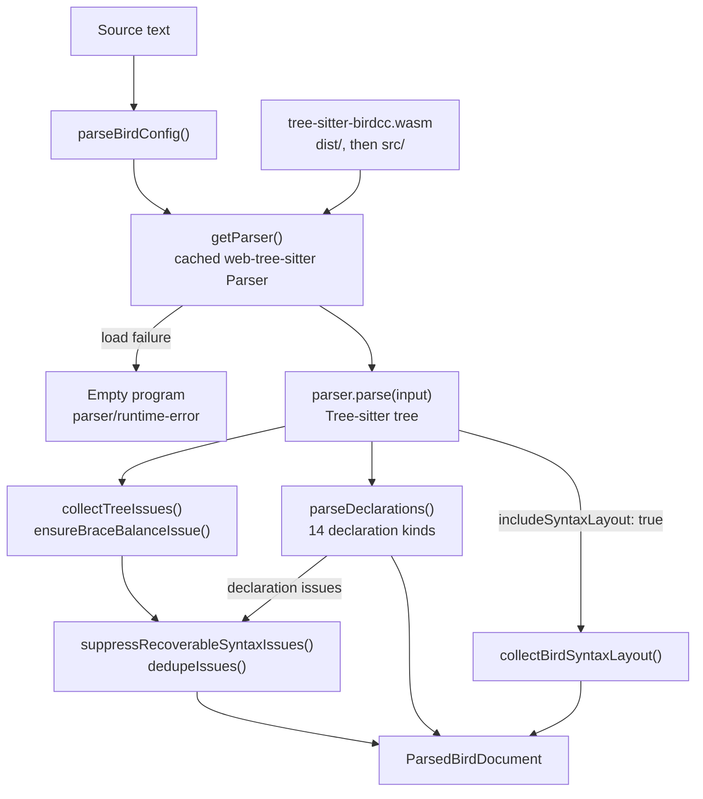

## Core

### Snapshot

`buildCoreSnapshotFromParsed` in `@birdcc/core` analyzes one parsed document. It builds a symbol table of `define`, `protocol`, `template`, `filter`, `function`, and `table` declarations, collects semantic diagnostics (router id, neighbor address, prefix literals), template inheritance cycles, duplicate definitions, and undefined template references, and runs the type checker over filter and function bodies. `buildCoreSnapshot` is the async wrapper that parses the text first.

Arrows show the order of calls and the flow of data.

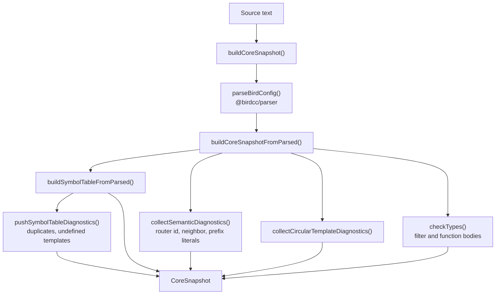

### Cross-file resolution

`resolveCrossFileReferences` follows `include` statements from an entry file breadth-first. Every file passes a workspace-root check and byte budgets before it is parsed (2 MiB per file, 16 MiB for the graph), and the queue stops at depth 16 and 256 files by default. Parsed documents come from a process-wide cache of 512 documents and 16 MiB. After the queue is empty, the per-file symbol tables are merged, so duplicate definitions and template references are checked across files. A file that is already visited or queued is skipped, which ends include cycles without a diagnostic. [analysis-budgets.md](./analysis-budgets.md) lists the byte budgets and cache limits and the project settings that change them.

Arrows show the order of calls and the flow of data. The dotted arrow is the failure path.

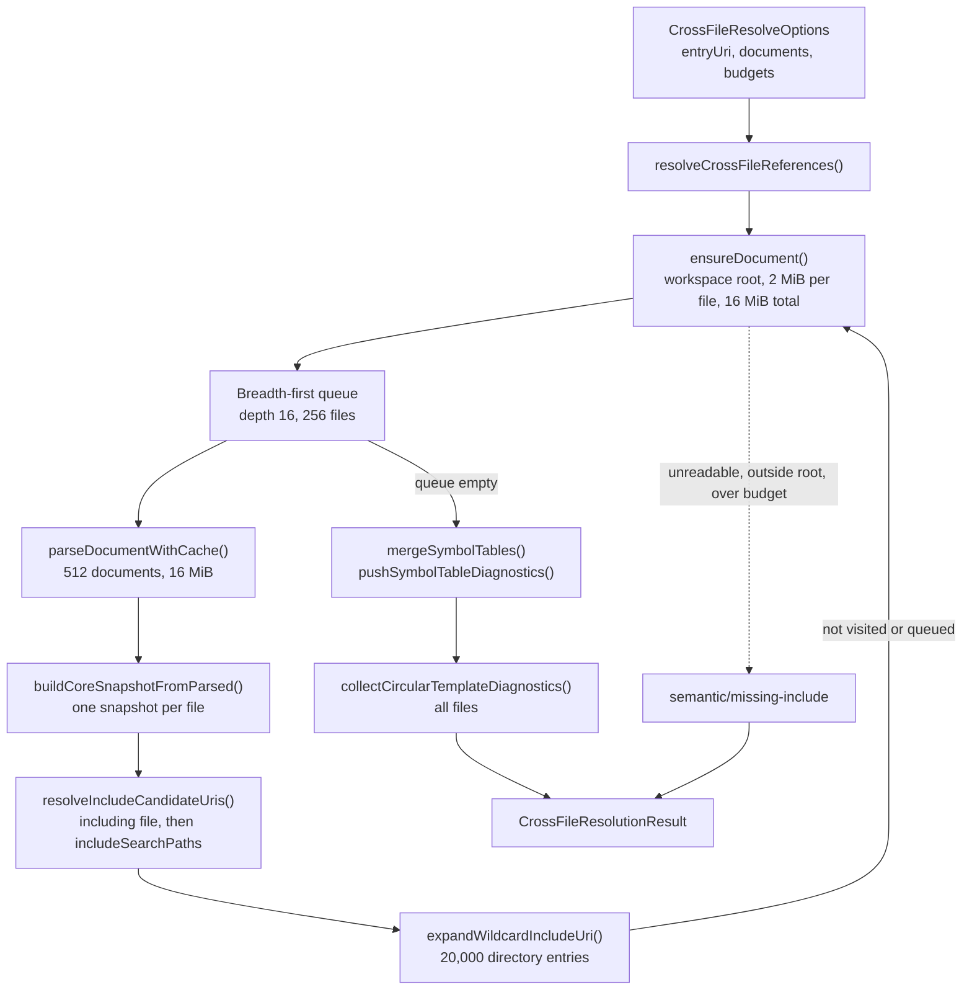

## Linter

`lintBirdConfig` in `@birdcc/linter` reuses a parsed document and core snapshot when the caller passes them, and otherwise creates both. It maps parser and core diagnostics to rule codes with default severities, runs the rule functions of six groups, drops diagnostics that a fragment or library file cannot resolve on its own, and removes duplicates. Default severities are `warning` for `sym`, `cfg`, `net`, and `type` rules and `info` for `bgp` and `ospf` rules. The language server then applies `linter.rules` from `bird.config.json` with `applyLintConfiguration` from `@birdcc/core`, and the CLI with its own `applySeverityOverrides`. Both resolve each code with `resolveSeverityOverride` from `@birdcc/core`: an exact rule code wins, then the longest matching `prefix/*` key, and `off` removes the diagnostic.

Arrows show the order of calls and the flow of data.

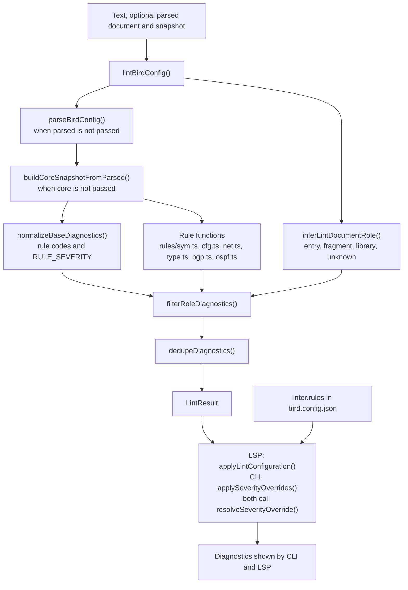

## Formatter

### Engines

`formatBirdConfig` in `@birdcc/formatter` fills in defaults (`dprint`, indent 2, width 80, spaces, safe mode on) and runs the selected engine. The `dprint` engine hosts the WebAssembly plugin from `@birdcc/dprint-plugin-bird` in a `@dprint/formatter` context, cached per option set (up to 16 contexts). When it throws and the caller did not pass `engine`, the text is formatted again with the `builtin` engine; when the caller passed `engine: "dprint"`, the error propagates. Both engines use the same line-based algorithm: indentation from bracket tokens in the Tree-sitter tree, blank-line collapsing, and no line wrapping.

Arrows show the order of calls and the flow of data.

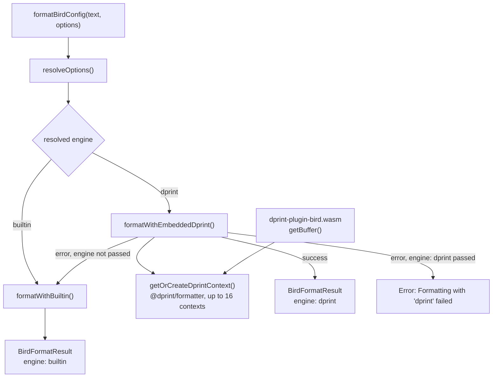

### Safe mode

With `safeMode` on, changed output must parse to the same result as the input. Both engines compare a semantic fingerprint built from `@birdcc/parser` output: the declaration tree without source ranges and with whitespace in text collapsed, plus the code and message of each parse issue. The `dprint` engine adds a check inside the Rust plugin that compares Tree-sitter node kinds, child counts, missing-node flags, and token text. A file with syntax errors is formatted when its parse issues stay the same.

Arrows show the order of calls and the flow of data.

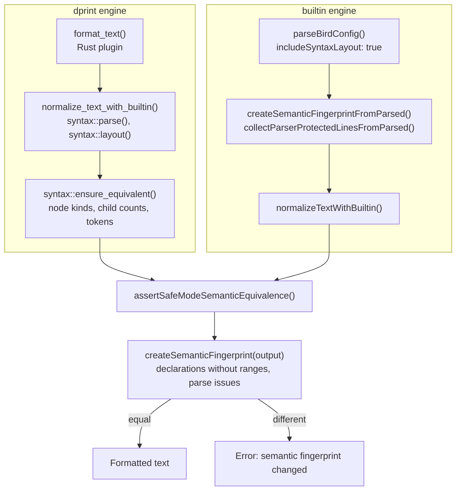

## dprint plugin build and distribution

`build.rs` in `@birdcc/dprint-plugin-bird` runs the pinned `tree-sitter-cli` on `packages/@birdcc/parser/grammar.js`, writes `parser.c` to Cargo's `OUT_DIR`, and compiles it with the `cc` crate, so the WebAssembly module embeds the same grammar as `@birdcc/parser`. `scripts/build-wasm.mjs` builds the crate for `wasm32-unknown-unknown` with the `wasm` feature and copies the module to `dist/dprint-plugin-bird.wasm`; `dist/index.js` exposes it through `getPath()` and `getBuffer()`, and the release workflow publishes the package to npm with Tegami. `@birdcc/formatter` passes `getBuffer()` to `addPlugin()` on a `@dprint/formatter` context for its default `dprint` engine, and the dprint CLI loads the same file through a path or an `npm:` specifier.

Arrows follow the build and data flow, from sources to consumers.

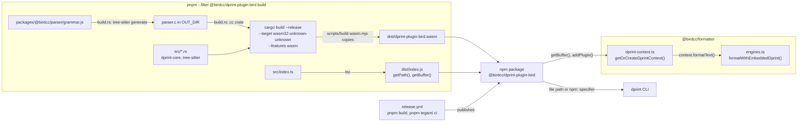

## LSP diagnostics pipeline

Every open or change event invalidates the affected entries and schedules validation per document URI; the scheduler waits 120 ms after the last event and drops results that a newer event superseded. Validation resolves the project for the document, checks the size budget and document eligibility, then resolves the include graph from the entry file and lints the whole graph. Diagnostics for the other files of the graph are published during the analysis, and the scheduler publishes the diagnostics of the document itself. When `crossFile.enabled` is `false`, the document is linted on its own with `lintBirdConfig`.

Arrows show messages and calls in time order.

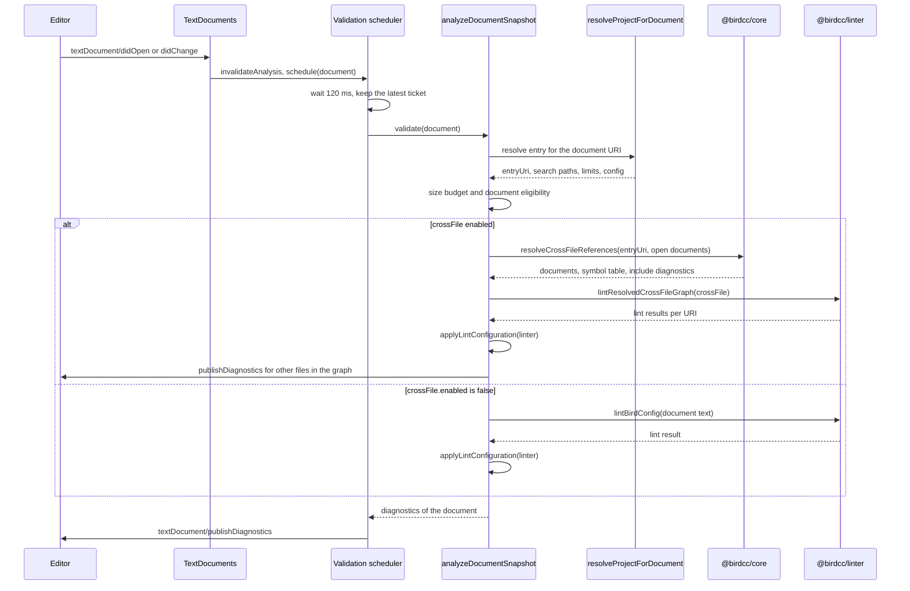

## Project entry resolution

`birdcc` and the language server load the nearest `bird.config.json` or `birdcc.config.json` with the same loader, but pick the entry of the include graph differently. `birdcc lint` takes its targets from the file argument; without one, it uses `workspaces` when the config sets them and `main` otherwise. For a target without an `include` line it runs entry detection in the target's directory and up to four parent directories. The language server takes the entry from `workspaces` or `main` when a config file exists and runs entry detection in the containing workspace folder otherwise. Both append `includePaths`, resolved against the config file's directory, to the include search paths.

Arrows show control flow.

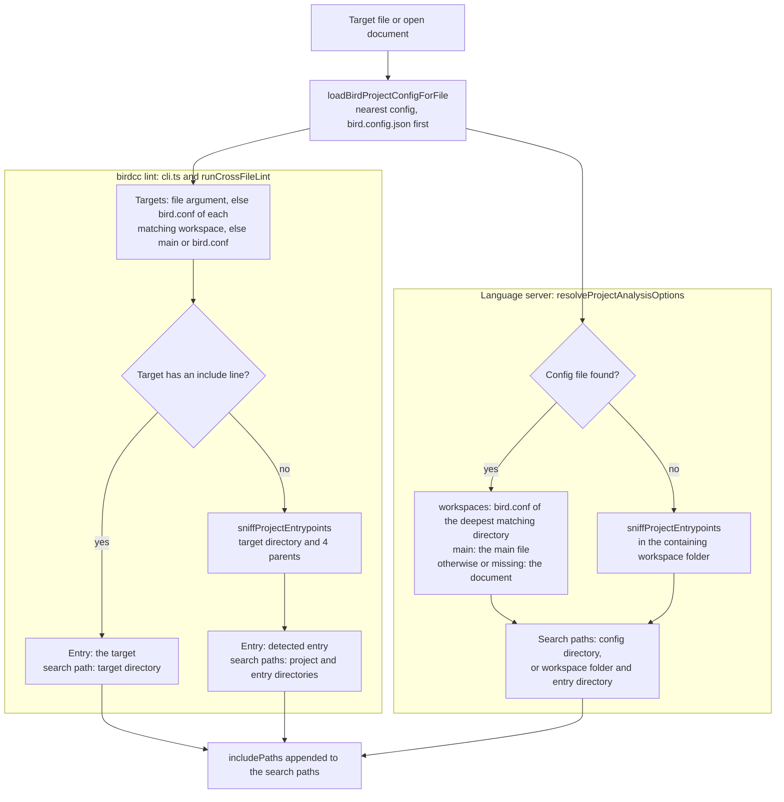

## CLI lint pipeline

`birdcc lint` loads the project config, then calls `runLint` for each target. Static analysis runs on the include graph by default and on the single file with `--no-cross-file` or `crossFile.enabled: false`. With `--bird` or `linter.withBird`, `runBirdValidation` runs the first available validation command template without a shell and converts its stderr into diagnostics. Severity overrides from `linter.rules` apply last, and the command exits with status 1 when any diagnostic has severity `error`.

Arrows show control flow.

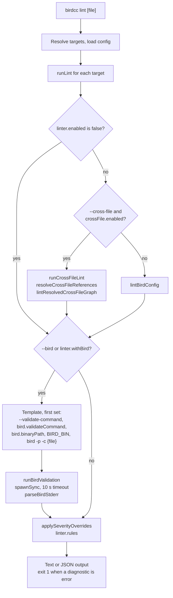

## ASN intelligence data flow

`scripts/build-db.ts` in `@birdcc/intel` downloads `asns/asns.csv` from the `auto-update` branch of BGP.Tools-OpenDB, sorts the rows by ASN, and writes a gzip-compressed four-column MessagePack file to `packages/@birdcc/intel/db/asn-db.bin.gz`. The `intel-asn-update.yml` workflow runs this script every Monday at 04:00 UTC; when the file changed, `tools/intel-release-note.mjs` adds a Tegami patch changeset and the workflow opens a pull request from `feat/weekly-asn-database`, and the merged file ships with the next `@birdcc/intel` release. At startup `startLspServer()` calls `createAsnIntel()`, which validates the file and builds lookup maps; the completion, hover, and inlay hint handlers query it unless `bird2-lsp.intel.enabled` or the setting of that feature (`intel.completion`, `intel.hover`, `intel.inlayHints`) is `false`.

Arrows follow the data from the upstream CSV to the language server features.

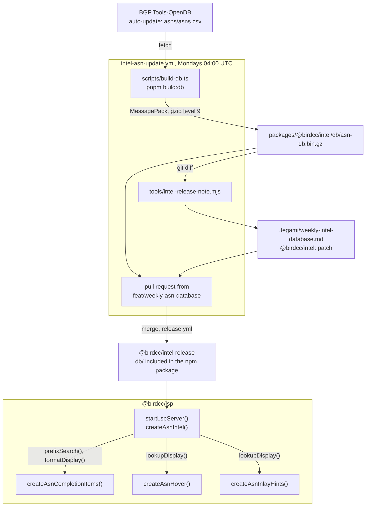

## VS Code extension

### Starting the language server

VS Code activates the extension only in a trusted workspace, because the manifest does not declare `capabilities.untrustedWorkspaces`. The extension starts the bundled language server when `bird2-lsp.serverPath` keeps its default value `["birdcc", "lsp", "--stdio"]` and `node_modules/@birdcc/lsp/dist/server.js` exists in the extension directory. It runs that file with `process.execPath`, the VS Code executable, and sets `ELECTRON_RUN_AS_NODE=1` and `ELECTRON_NO_ASAR=1`, so neither Node.js nor `@birdcc/cli` has to be installed. Otherwise `resolveServerCommand()` splits a string `serverPath` into tokens and rejects shell executables and shell wrappers, and the extension spawns the command without a shell. If `client.start()` fails or does not finish within `bird2-lsp.performance.startupTimeoutMs`, the extension terminates the server process. In that case, and when a running client stops without the extension stopping it, the lifecycle state becomes `error` and the extension starts fallback validation.

An arrow points from a step to the step that follows it.

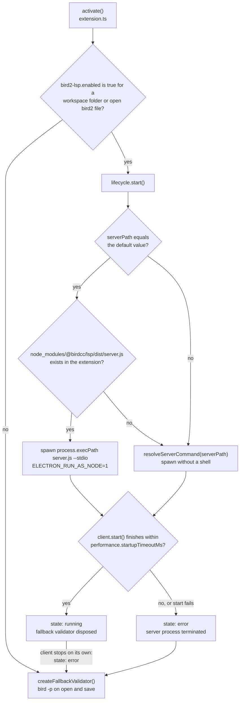

### Providers in the extension host

Besides the language client, the extension registers its own providers in the extension host. Format Document and Format Selection call `formatBirdConfig()` from `@birdcc/formatter`, with `formatter` options from `bird.config.json` (read by `loadBirdProjectConfigForFile()`) taking precedence over extension settings and editor indentation; Format Selection keeps only the edits inside the selection. Function return-type hover and inlay hints call `collectFunctionReturnHints()` from `@birdcc/core`. Keyword hover calls `resolveKeywordHoverOnLine()` from the `@birdcc/lsp` library and returns nothing while the language server is running for the file. Every provider first applies `enforceLargeFileGuard()` and then the document admission check, which looks for a project file whose `main` points to the document and calls `evaluateBirdDocumentEligibility()`. While the server runs, the language client also registers the server's providers for `bird2` documents, among them Format Document (`documentFormattingProvider`), hover, and inlay hints for AS numbers and function return types. Format Selection has a provider only in the extension host.

An arrow points from a caller to the module it calls.

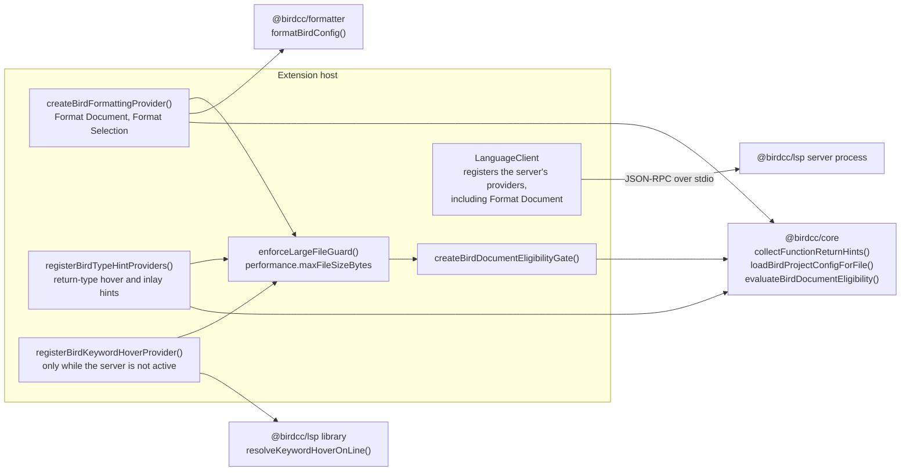

### Fallback validation

Fallback validation runs the BIRD binary on saved files and turns its output into diagnostics in the `bird2-fallback` collection with source `bird -p`. A background validator exists while `bird2-lsp.enabled` is `false` or the client is in the `error` state; a second one covers files whose resource-level `enabled` is `false` while the server runs. Background validators check the active file when they start and other files 800 ms after open, or after save while `bird2-lsp.validation.onSave` is `true`; the **BIRD2: Validate Active Document** command uses a separate validator that runs once on demand. Each run passes the same checks before `execFile()` starts the command without a shell. [configuration.md](./configuration.md#validation-command-safety) lists the command template rules.

An arrow points from a trigger or step to the step that follows it.

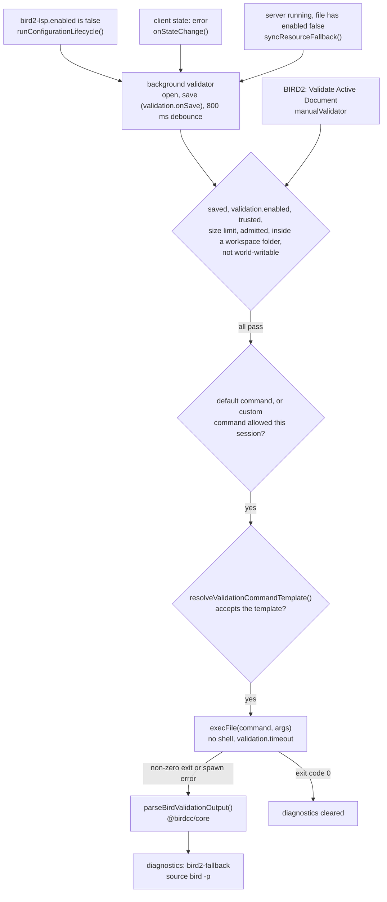
