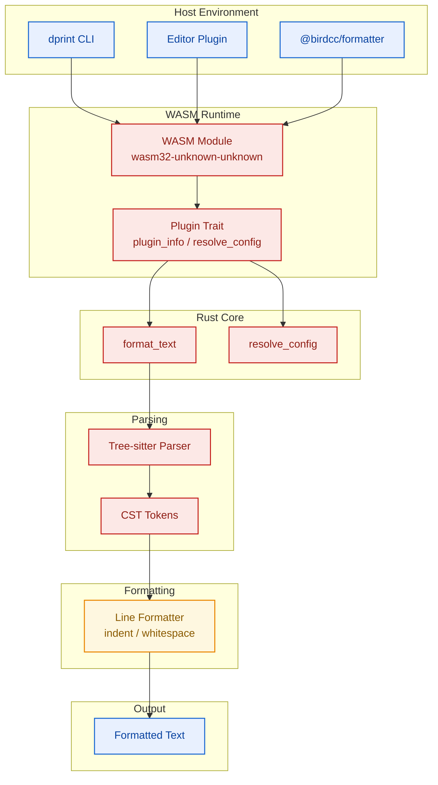
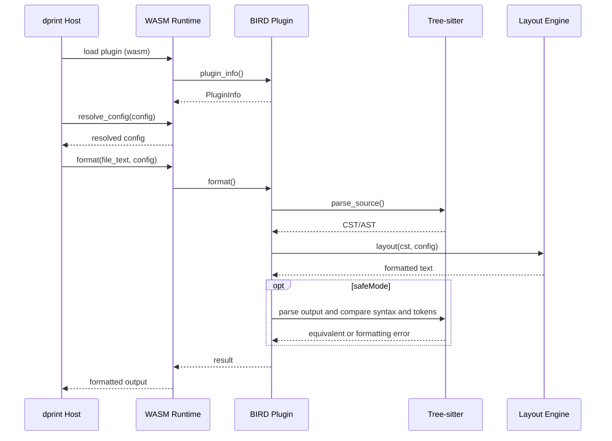
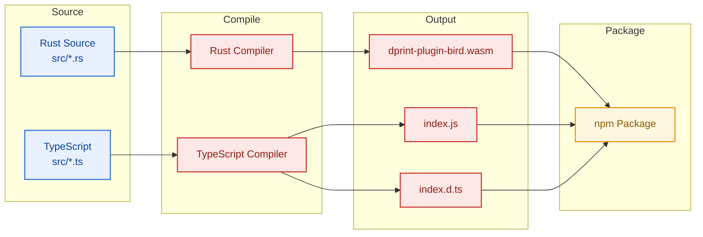

<div align="center">


# dprint Plugin for BIRD Config (@birdcc/dprint-plugin-bird)

</div>

<div align="center">

> ⚠️ **Alpha Stage**: This package is in early development. APIs may change frequently, and unexpected issues may occur. Please evaluate carefully before deploying in production environments.

</div>

[](https://www.npmjs.com/package/@birdcc/dprint-plugin-bird) [](https://www.gnu.org/licenses/gpl-3.0) [](https://www.rust-lang.org/) [](https://webassembly.org/)

> [Overview](#overview) · [Features](#features) · [Installation](#installation) · [Usage](#usage) · [Configuration](#configuration) · [Architecture](#architecture) · [Development](#development)

## Overview

**@birdcc/dprint-plugin-bird** is the official dprint plugin for BIRD Internet Routing Daemon (BIRD2) configuration files. Built with Rust and compiled to WebAssembly, it delivers blazing-fast, cross-platform code formatting.

This plugin is part of the [BIRD-LSP](https://github.com/bird-chinese-community/BIRD-LSP) toolchain, providing enterprise-grade formatting capabilities for network engineers.

---

## Features

| Feature                    | Description                                       |
| -------------------------- | ------------------------------------------------- |
| 🚀 **Rust Performance**    | Core engine written in Rust for maximum speed     |
| 🌍 **Cross-Platform WASM** | Compiled to wasm32-unknown-unknown                |
| 🔌 **dprint Compatible**   | Seamlessly integrates with dprint CLI and editors |
| 🌳 **Tree-sitter**         | Leverages Tree-sitter for syntax-aware formatting |
| ⚙️ **Configurable**        | Supports `lineWidth`, `indentWidth`, `safeMode`   |
| 🦀 **Memory Safe**         | Rust's ownership model guarantees safety          |

---

## Installation

### Prerequisites

- **Node.js** ≥ 20 to load the npm package
- **Rust stable**, **Clang**, **Node.js**, and **pnpm** to build from a repository checkout
- **wasm32-unknown-unknown** target and **llvm-tools** component for WASM builds

### Setup Rust WASM Target

```bash
rustup target add --toolchain stable wasm32-unknown-unknown
rustup component add --toolchain stable llvm-tools
```

### Install via npm

```bash
npm install @birdcc/dprint-plugin-bird
```

---

## Usage

### With dprint CLI

Add to your `dprint.json`:

```json
{
  "plugins": [
    "./node_modules/@birdcc/dprint-plugin-bird/dist/dprint-plugin-bird.wasm"
  ],
  "bird": {
    "lineWidth": 100,
    "indentWidth": 2,
    "useTabs": false,
    "safeMode": true
  }
}
```

Then run:

```bash
dprint fmt bird.conf
dprint check bird.conf
```

### Via @birdcc/formatter

When configured with `engine: "dprint"`, this plugin is automatically used:

```json
{
  "$schema": "https://raw.githubusercontent.com/bird-chinese-community/BIRD-LSP/main/schemas/bird.config.schema.json",
  "formatter": {
    "engine": "dprint",
    "indentSize": 2,
    "lineWidth": 100,
    "safeMode": true
  }
}
```

### Programmatic Usage

```typescript
import { getPath, getBuffer } from "@birdcc/dprint-plugin-bird";

// Get WASM file path
const wasmPath = getPath();

// Or get WASM buffer directly
const wasmBuffer = getBuffer();
```

---

## Configuration

### Options

| Option        | Type      | Default | Description                                           |
| ------------- | --------- | ------- | ----------------------------------------------------- |
| `lineWidth`   | `number`  | `80`    | Maximum line length                                   |
| `indentWidth` | `number`  | `2`     | Spaces per indentation level                          |
| `safeMode`    | `boolean` | `true`  | Reject changes to Tree-sitter syntax or token content |

The Rust plugin parses input with the shared BIRD grammar. Indentation uses structural tokens, so braces inside strings and comments do not affect subsequent lines. Multiline comment contents retain their layout. With `safeMode: true`, the plugin parses its output and compares syntax structure, missing tokens, and leaf-token contents before returning it. Comment line endings may be normalized. Other token content changes produce a formatting error. This check also runs when a dprint host loads the WASM directly.

---

## Architecture

### Plugin Architecture



### Data Flow



### Build Pipeline



---

## Development

### Build

Execute from the monorepo root:

```bash
pnpm build
```

This command performs:

1. Generates C parser sources from `packages/@birdcc/parser/grammar.js` into Cargo's output directory
2. Compiles Rust and the generated grammar to WebAssembly (`wasm32-unknown-unknown`)
3. Generates TypeScript declaration files
4. Outputs to the `dist/` directory

Run `pnpm install` in the repository before building or running Cargo tests. Grammar generation uses the package's pinned Tree-sitter CLI. The npm tarball contains the compiled WASM and JavaScript bindings; consumers load files from `dist/`. Source builds use the shared grammar in the repository checkout. The build script selects the Rust toolchain's `llvm-ar`; `AR_wasm32_unknown_unknown` can select another LLVM archive tool.

The C compiler must support the `wasm32-unknown-unknown` target. On macOS, install LLVM Clang and set `CC_wasm32_unknown_unknown` to its executable when the system Clang omits this target. The native smoke workflow uses `macos-latest`, selects its preinstalled Homebrew `llvm@20` compiler, and verifies that it can emit a WASM object before building the plugin.

The Rust runtime uses Tree-sitter 0.27.1 and tree-sitter-language 0.1.9. This release pair provides a standalone WASM standard library backed by Rust's global allocator. Cargo.lock fixes the resolved source and build dependencies.

### Manual Build Steps

```bash
# Build WASM
node scripts/build-wasm.mjs

# Compile TypeScript
tsc -p tsconfig.json
```

### Project Structure

| Path                     | Description                              |
| ------------------------ | ---------------------------------------- |
| `src/lib.rs`             | Library entry point                      |
| `src/configuration.rs`   | Configuration structures                 |
| `src/format_text.rs`     | Core formatting implementation           |
| `src/syntax.rs`          | Shared grammar parsing and output checks |
| `build.rs`               | Generate and compile the BIRD grammar    |
| `src/wasm_plugin.rs`     | WASM bindings                            |
| `src/index.ts`           | TypeScript bindings                      |
| `scripts/build-wasm.mjs` | WASM build script                        |
| `dist/`                  | Build output directory                   |

### Available Scripts

| Command          | Description                  |
| ---------------- | ---------------------------- |
| `pnpm build`     | Build WASM + TypeScript      |
| `pnpm test`      | Run Rust unit tests          |
| `pnpm typecheck` | Run TypeScript type checking |
| `pnpm lint`      | Run oxlint and cargo clippy  |
| `pnpm format`    | Format code using oxfmt      |

### Testing

```bash
# Run Rust tests
cargo test

# Run with output
cargo test -- --nocapture
```

---

## Relationship with @birdcc/formatter

| Package                      | Role                  | Description                             |
| ---------------------------- | --------------------- | --------------------------------------- |
| `@birdcc/dprint-plugin-bird` | **dprint Plugin**     | Official dprint plugin for BIRD2        |
| `@birdcc/formatter`          | **Abstraction Layer** | Unified interface with multiple engines |

`@birdcc/formatter` serves as a higher-level abstraction that can use this dprint plugin as its backend, while also providing a built-in fallback formatter.

---

## Related Packages

| Package                            | Description                    |
| ---------------------------------- | ------------------------------ |
| [@birdcc/parser](../parser/)       | Tree-sitter grammar and parser |
| [@birdcc/core](../core/)           | Semantic analysis engine       |
| [@birdcc/formatter](../formatter/) | Unified formatting interface   |
| [@birdcc/linter](../linter/)       | Lint rules and diagnostics     |
| [@birdcc/lsp](../lsp/)             | LSP server implementation      |
| [@birdcc/cli](../cli/)             | Command-line interface         |

---

### 📖 Documentation

- [BIRD Official Documentation](https://bird.network.cz/)
- [BIRD2 User Manual](https://bird.network.cz/doc/bird.html)
- [dprint Documentation](https://dprint.dev/)
- [GitHub Project](https://github.com/bird-chinese-community/BIRD-LSP)

---

## 📝 License

GPL-3.0-only © [BIRD Chinese Community](https://github.com/bird-chinese-community/)

---

<p align="center">
  <sub>Built with ❤️ by the BIRD Chinese Community (BIRDCC)</sub>
</p>

<p align="center">
  <a href="https://github.com/bird-chinese-community/BIRD-LSP">🕊 GitHub</a> ·
  <a href="https://marketplace.visualstudio.com/items?itemName=birdcc.bird2-lsp">🛒 Marketplace</a> ·
  <a href="https://github.com/bird-chinese-community/BIRD-LSP/issues">🐛 Report Issues</a>
</p>
